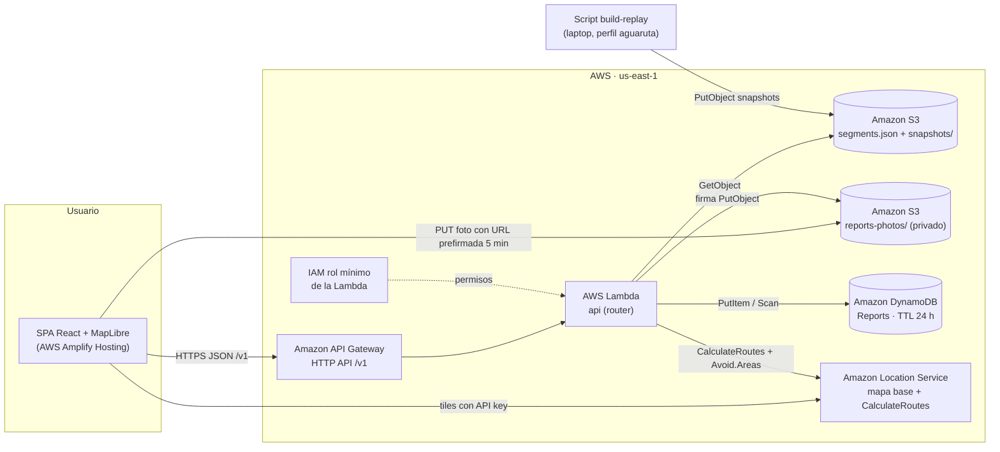

# Arquitectura — AguaRuta Mérida

| Servicio | Uso |
|---|---|
| AWS Amplify Hosting | Sirve la SPA |
| Amazon API Gateway (HTTP API) | Entrada `/v1` con CORS |
| AWS Lambda | Router `api`: riesgo, reportes, rutas |
| Amazon S3 | Segmentos, snapshots del replay, fotos (privado) |
| Amazon DynamoDB | Tabla `Reports` con TTL de 24 h |
| Amazon Location Service | Mapa base y `CalculateRoutes` con áreas a evitar |
| AWS IAM | Rol de mínimo privilegio de la Lambda |

En local la misma Lambda corre con `api/src/local-server.ts`: snapshots desde disco, reportes en memoria y ruteo con `LocalGraphRoutingProvider` (Dijkstra sobre los tramos).
