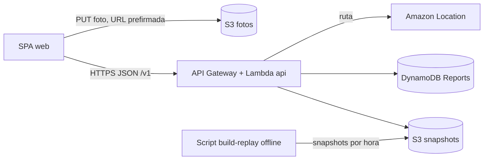
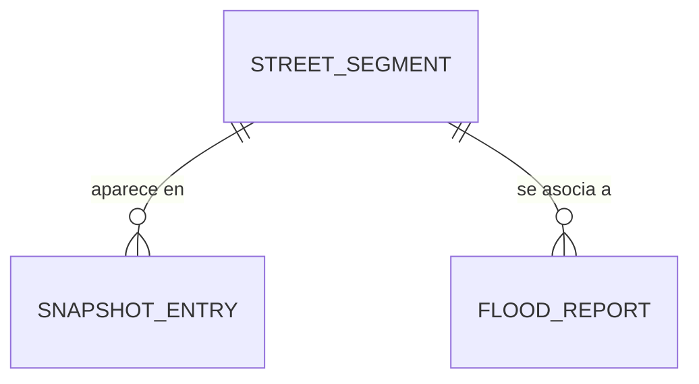

# AguaRuta Mérida: Especificación Técnica LITE (Hackathon)

> Versión 0.1.0-lite. El contrato OpenAPI (`contract/openapi.yaml`, antes sección 3 de este documento) es la fuente de verdad. Si el código, los tipos o los mocks difieren del contrato, el contrato gana.
> Objetivo: una **demo que funcione**. Todo lo que no sirva a la demo está en la lista "Post-MVP" al final.

**Demo en una línea:** mapa de riesgo por calle en Mérida, reproducción de la tormenta del 29-may-2026 con un control de tiempo, reporte ciudadano con foto que cambia el mapa, y ruta que evita calles de riesgo alto.

**Prioridad (recortar de abajo hacia arriba):** 1) mapa con replay, 2) ruta que evita riesgo, 3) reportes con foto.

---

## 1. Arquitectura y Flujo de Datos

### 1.1 Capas

| Capa | Tecnología | Responsabilidad |
|---|---|---|
| Cliente | SPA React + TypeScript + MapLibre GL en AWS Amplify | Mapa, reporte, ruta. Solo habla con la API REST. |
| API | API Gateway (HTTP API) + 1 Lambda `api` (router por ruta), base `/v1` | Lee snapshots, guarda reportes, calcula rutas. |
| Datos | S3 (segmentos, snapshots, fotos) + DynamoDB (solo `Reports`) | Persistencia mínima. |
| Mapas y rutas | Amazon Location Service tras la interfaz `RoutingProvider` | Mapa base y rutas con áreas a evitar. Alternativa: OSRM/Valhalla. |
| Cálculo de riesgo | Función pura `computeRisk` ejecutada **offline** por un script | Genera los snapshots del replay. |

Sin Cognito, sin EventBridge, sin Lambdas de ingesta en el MVP.

### 1.2 Desacoplamiento

- El cliente solo usa la API `/v1`. Excepciones: subida de fotos con URL prefirmada y teselas del mapa base.
- `VITE_API_BASE_URL` alterna entre mock (`http://127.0.0.1:4010/v1`) y API real sin cambiar código.
- `computeRisk` y el ajuste por reportes son funciones puras sin dependencias de AWS.
- `RoutingProvider` es una interfaz; el contrato no cambia si se cambia de motor.

### 1.3 Diagrama



### 1.4 Flujos

1. **Preparación (offline, una vez).** El script `build-replay` lee tramos (`segments.json`) y la lluvia del evento (`rain-2026-05-29.json`), ejecuta `computeRisk` por cada paso de 15 minutos y sube `snapshots/{yyyyMMddTHHmmZ}.json` a S3, más `snapshots/index.json` con los instantes disponibles.
2. **Mapa.** `GET /v1/risk/segments?bbox=…&asOf=…` → la API elige el snapshot más cercano anterior a `asOf` (o el último si no hay `asOf`), filtra por `bbox` en memoria, lee los reportes de la última hora, aplica el ajuste por reportes y devuelve un FeatureCollection.
3. **Reporte.** `POST /v1/reports/photo-upload-url` → `PUT` de la foto a S3 → `POST /v1/reports` con `photoKey`. La API asocia el reporte al tramo más cercano (≤ 30 m). Como el ajuste se aplica **al leer**, el mapa cambia en la siguiente consulta.
4. **Ruta.** `POST /v1/routes` → ruta base → tramos con nivel ≥ `avoidLevel` en el corredor → áreas a evitar → ruta alternativa → respuesta con ambas y `disclaimer`.

### 1.5 Decisiones

- **Coordenadas:** GeoJSON, siempre `[longitud, latitud]`.
- **Riesgo estimado, no garantía:** ninguna respuesta dice que una calle es transitable. Las respuestas de ruta incluyen `disclaimer`.
- **Sin autenticación en el MVP.** Los reportes son anónimos. Riesgo de spam aceptado para la demo.
- **Zona piloto:** Centro de Mérida y puntos críticos (Ciudad Caucel, Juan Pablo II, Mérida 2000, Miguel Hidalgo, Residencial del Norte). Cientos a pocos miles de tramos: el `bbox` se filtra en memoria.
- **Confirmado en la documentación de AWS:** Amazon Location Routes v2 (`CalculateRoutes`) acepta `Avoid.Areas` con `Polygon` o `BoundingBox`. Es una **preferencia, no una garantía** (la ruta puede cruzar el área si no hay alternativa razonable). Verificar al inicio: límites de áreas por solicitud, costos y disponibilidad de los datos de lluvia del evento.

### 1.6 Estructura del repositorio

```
/contract/openapi.yaml    contrato (fuente de verdad)
/web                      SPA
/api                      Lambda api (router) + RoutingProvider
/core                     computeRisk, applyReports (puras, con tests)
/scripts/build-replay.ts  genera snapshots
/data                     segments.json, rain-2026-05-29.json, model.json
```

### 1.7 Integración con AWS

**Todo servicio de AWS es una API HTTPS.** El cliente no usa credenciales AWS: solo habla con la API `/v1`. La Lambda `api` llama a los servicios con el AWS SDK v3 usando su rol IAM (sin claves en el código). Hay dos excepciones controladas: la subida de fotos (URL prefirmada) y los tiles del mapa (API key restringida).

| Servicio | Quién lo llama | Cómo | Credencial |
|---|---|---|---|
| API Gateway + Lambda `api` | Navegador | HTTPS JSON según el contrato `/v1` (CORS habilitado para el dominio de Amplify) | Ninguna en el MVP |
| S3 (`segments.json`, snapshots) | Lambda | SDK `GetObject`; se guarda en memoria entre invocaciones | Rol IAM |
| DynamoDB (`Reports`) | Lambda | SDK `PutItem` y `Scan` con filtro | Rol IAM |
| S3 (fotos) | Navegador, con URL que genera la Lambda | La Lambda firma un `PutObject` (5 min); el navegador hace `PUT` directo al bucket | Firma dentro de la URL |
| Amazon Location (mapa base) | Navegador (MapLibre) | URL de estilo y tiles con `?key=…` | API key limitada a mapas y al dominio de la app |
| Amazon Location (rutas) | Lambda, vía `RoutingProvider` | SDK `geo-routes`, `CalculateRoutes` con `Avoid.Areas` | Rol IAM |
| Script `build-replay` | Tu computadora | SDK con credenciales locales, `PutObject` a S3 | Perfil AWS local |

**Permisos mínimos del rol de la Lambda `api`:** `s3:GetObject` (bucket de snapshots), `s3:PutObject` (bucket de fotos, necesario para firmar la URL), `dynamodb:PutItem` y `dynamodb:Scan` (tabla `Reports`), y `geo-routes:CalculateRoutes`.

**Variables de entorno de la Lambda:** `SNAPSHOT_BUCKET`, `PHOTOS_BUCKET`, `REPORTS_TABLE`. El cliente recibe en build `VITE_API_BASE_URL` y `VITE_MAP_STYLE_URL` (incluye la API key de mapas).

**Fotos (sin pasar por la Lambda):**
1. `POST /reports/photo-upload-url` → la Lambda crea la URL con `getSignedUrl(s3, new PutObjectCommand({ Bucket, Key, ContentType }), { expiresIn: 300 })`.
2. El navegador hace `PUT` de la imagen a `uploadUrl` con el mismo `Content-Type`.
3. `POST /reports` envía solo `photoKey`. El bucket es privado y necesita CORS para `PUT` desde el dominio de la app.

**Ruteo con áreas a evitar (dentro de `RoutingProvider`):**
1. Ruta base: `CalculateRoutes(Origin, Destination, TravelMode)`.
2. Tramos con nivel ≥ `avoidLevel` cerca de esa ruta (del snapshot + reportes) → polígonos con un buffer de unos 15 m.
3. Ruta alternativa: `CalculateRoutes(..., Avoid: { Areas: [{ Geometry: { Polygon: [...] } }] })`.
4. Como la evitación es una preferencia, se comprueba si la geometría resultante aún cruza tramos de riesgo alto: el resultado se reporta en `residualRiskLevel`, y si no hay alternativa aceptable se responde `ROUTE_NOT_FOUND`.

**Orden recomendado para conectar:** primero S3 y la lectura de snapshots (Fase 3), luego `CalculateRoutes` (Fase 4) y al final DynamoDB y las fotos (Fase 5). Mientras tanto el cliente sigue usando el mock; el cambio a AWS es solo `VITE_API_BASE_URL`.

---

## 2. Modelos de Datos y Entidades

### 2.1 Entidades



**StreetSegment** (archivo `segments.json`, estático; generado desde OSM + elevación INEGI)

| Campo | Tipo | Notas |
|---|---|---|
| `segmentId` | string | Ej. `seg_8f3a1c` |
| `name` | string \| null | |
| `geometry` | LineString | `[lon, lat][]` |
| `relativeElevationM` | number | Negativo = punto bajo |
| `inDepression` | boolean | |
| `historicalFloodCount` | number | Eventos históricos |

**Snapshot** (S3 `snapshots/{yyyyMMddTHHmmZ}.json`)

`{ computedAt, modelVersion, rainfall: { accum1hMm, accum3hMm }, entries: SnapshotEntry[] }`

**SnapshotEntry:** `segmentId`, `score` (0–1), `level` (`low` | `medium` | `high`), `rainfall1hMm`, `rainfall3hMm`. La geometría y el nombre se unen desde `segments.json` (cargado en memoria al arrancar la Lambda).

**FloodReport** (DynamoDB tabla `Reports`, PK `reportId` ULID, TTL `expiresAt` a 24 h)

| Campo | Tipo | Notas |
|---|---|---|
| `reportId` | string | ULID |
| `location` | Point | |
| `segmentId` | string \| null | Tramo ≤ 30 m; null si no hay |
| `waterLevel` | enum | `puddle`, `ankle`, `knee`, `impassable` |
| `notes` | string \| null | ≤ 280 caracteres |
| `photoKey` | string \| null | Clave en S3 |
| `createdAt` | ISO 8601 | |
| `expiresAt` | number | Epoch s |

Lectura de reportes recientes: `Scan` con filtro por `createdAt` (tabla pequeña en demo). Fotos en `reports-photos/{reportId}/{uuid}.jpg`.

### 2.2 Modelo de riesgo v0 (heurístico, configurable)

```
score = clamp01(
    0.35 * norm(accum1hMm, rain1hRef)
  + 0.20 * norm(accum3hMm, rain3hRef)
  + 0.20 * lowPoint(relativeElevationM)
  + 0.15 * (inDepression ? 1 : 0)
  + 0.10 * norm(historicalFloodCount, historyRef)
)
level = score < 0.33 ? "low" : score < 0.66 ? "medium" : "high"
```

Pesos y referencias en `data/model.json`, calibrados a ojo con el evento del 29-may y sin hardcodear.

**Ajuste por reportes (`applyReports`, al leer):** cada reporte no vencido de la última hora sobre el tramo suma `0.10` al `score` (tope `+0.30`). Un reporte `impassable` fija `level = high`. Ante duda, no subestimar el riesgo.

---

## 3. Especificación OpenAPI 3.0 (Contrato Estricto)

Ver `contract/openapi.yaml` (copia literal de esta sección; es la fuente de verdad).

## 4. Interfaces de Tipado

Ver `web/src/api/types.ts` (derivado de `openapi.yaml` v0.1.0-lite; si el contrato cambia, se actualiza ese archivo).

---

## 5. Fases de Implementación

Regla: **mock primero, lógica real después.** Cada fase tiene un "hecho cuando" verificable.

### Fase 0: Arranque (≈ 30 min)
- Repo con la estructura de 1.6; `contract/openapi.yaml` y `types.ts` desde las secciones 3 y 4.
- Verificar en la documentación vigente las áreas a evitar de Amazon Location y los datos de lluvia del 29-may.
- **Hecho cuando:** `npx @stoplight/prism-cli mock contract/openapi.yaml -p 4010` responde.

### Fase 1: Cliente contra el mock
- Mapa con capa de riesgo por color, control de tiempo (`asOf`), formulario de reporte (foto simulada), pantalla de ruta, manejo de 400/404/500 mostrando `error.message` y `disclaimer` visible siempre.
- **Hecho cuando:** el flujo completo funciona sin AWS.

### Fase 2: Datos y replay (en paralelo con la Fase 1)
- Generar `segments.json` (OSM + elevación) de la zona piloto y cargar `rain-2026-05-29.json`.
- `computeRisk` con tests unitarios; `scripts/build-replay.ts` genera y sube los snapshots.
- **Hecho cuando:** hay snapshots por cada 15 minutos del evento y los tramos de las calles inundadas reportadas salen en `medium` o `high`.

### Fase 3: API real (lectura)
- Lambda `api` + API Gateway; `GET /risk/segments` leyendo snapshots de S3.
- **Hecho cuando:** el cliente muestra el replay real cambiando solo `VITE_API_BASE_URL`.

### Fase 4: Ruteo
- `RoutingProvider` con Amazon Location (o OSRM/Valhalla); `POST /routes` con ruta base, tramos a evitar, ruta alternativa y `ROUTE_NOT_FOUND`.
- **Hecho cuando:** en el pico del replay, la ruta alternativa evita los tramos en `high` (verificado contra su geometría, ya que la evitación es preferencia) con un aumento de tiempo razonable.

### Fase 5: Reportes
- Tabla `Reports`, `photo-upload-url`, `POST/GET /reports`, `applyReports` al leer.
- **Hecho cuando:** un reporte con foto cambia el color del tramo en el mapa; uno `impassable` lo deja en `high`.

### Fase 6: Demo (últimas horas)
- Guion: replay del evento, reporte en vivo, ruta antes y después. Plan B: el mismo flujo sobre el mock si falla la red.
- **Hecho cuando:** la demo corre dos veces seguidas sin intervención manual.

### Post-MVP (no construir ahora)
Cognito y límite de tasa · `Idempotency-Key` · índice `geohash5` en DynamoDB · ingesta de lluvia en vivo con EventBridge · `GET /zones`, `GET /reports/{id}`, paginación · tests de contrato y CI · infraestructura como código · filtro de fotos con Bedrock · avisos con SNS · sensores con IoT Core.

### Orden de recorte
Reportes con foto → ruteo → mapa con replay (esto último nunca se recorta).
